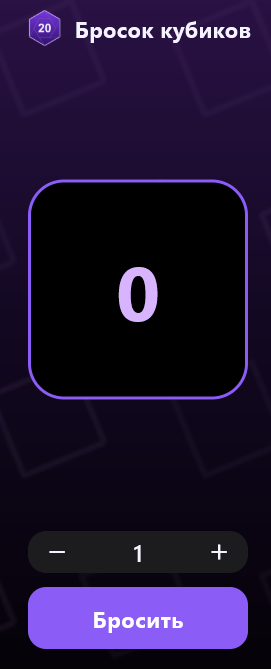

# Лабораторная работа №6. Бросок кубиков

Приложение-кубик: задаёшь количество кубиков и бросаешь. На карточке показывается сумма — за один кубик от 1 до 6, за несколько кубиков сумма всех бросков.


## Автор

Окишев М. С., группа ИСП-242, 23.10.2026

## Скриншот



## Стек и среда разработки

- Flutter 3.47.7
- Dart 3.13.5
- Платформа: Web (Chrome)
- IDE: VS Code

## Структура проекта

```text
lib/
├── main.dart                 — точка входа, MaterialApp и тёмная тема
├── dice_screen.dart          — экран броска: состояние и вся логика
├── app_header.dart           — шапка с картинкой и названием
├── dice_result.dart          — карточка с числом результата
├── count_stepper.dart        — счётчик количества «− 1 +»
├── roll_button.dart          — кнопка «Бросить»
├── gradient_background.dart  — фон: градиент и текстура кубиков
└── app_colors.dart           — палитра приложения

assets/images/                — изображения кубиков (d20_icon, dice_trio, dice_pattern),
                                подключены в pubspec.yaml
img/                          — скриншоты для README
```

## Как запустить проект

```bash
git clone https://github.com/Korand-py/flutter_lab6.git
cd flutter_lab6
flutter pub get
flutter run -d chrome
```

## Что изучили

- Как разложить экран на мелкие виджеты и развести их по файлам, чтобы `main.dart` остался коротким.
- Чем `StatefulWidget` отличается от `StatelessWidget` на практике: в первом лежит изменяемое состояние, второй просто рисует то, что ему передали.
- Как передавать данные и колбэки вниз по дереву через конструктор, чтобы дочерние виджеты не знали лишнего.
- Как подключить картинки через `assets` в `pubspec.yaml` и показать их через `Image.asset`.
- Как собрать фон через `LinearGradient` и вынести цвета в один класс-палитру.
- Как получить случайное число через `Random` из `dart:math` и сложить результаты нескольких бросков.
